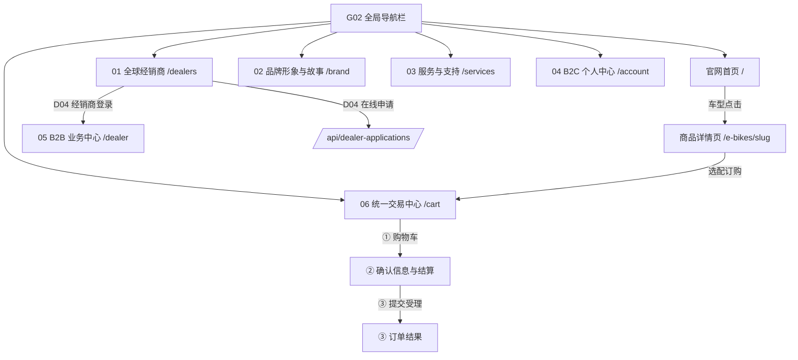

# ALSVID 官方全站 6 大核心页面 UI Wireframe 布局框架与技术落地规范

> **版本**：v2.0-Wireframe-Final  
> **适用范围**：机器人/自动化前端页面生产、CMS 统一装修工作台模块映射、工程师组件开发基准。  
> **设计原则**：德系工程极简美学、全幅大图少文字、模块化解耦、数据主档强一致性。

---

## 目录
1. [全站页面关系与流转拓扑（Sitemap & Flow）](#1-全站页面关系与流转拓扑sitemap--flow)
2. [页面 01 · 全球经销商页面 (`/dealers`)](#2-页面-01--全球经销商页面-dealers)
3. [页面 02 · 品牌形象与品牌故事 (`/brand`)](#3-页面-02--品牌形象与品牌故事-brand)
4. [页面 03 · 服务与支持页面 (`/services`)](#4-页面-03--服务与支持页面-services)
5. [页面 04 · B2C 个人中心 (`/account`)](#5-页面-04--b2c-个人中心-account)
6. [页面 05 · B2B 经销商业务中心 (`/dealer`)](#6-页面-05--b2b-经销商业务中心-dealer)
7. [页面 06 · 统一交易页面 (`/cart`)](#7-页面-06--统一交易页面-cart)
8. [公共全局模块规范（G01 ~ G04）](#8-公共全局模块规范g01--g04)
9. [机器自动化生产映射表（Component & Props Schema）](#9-机器自动化生产映射表component--props-schema)

---

## 1. 全站页面关系与流转拓扑（Sitemap & Flow）



---

## 2. 页面 01 · 全球经销商页面 (`/dealers`)

### 2.1 纵向布局结构
```
┌──────────────────────────────────────────────────────────┐
│ G01 · 营销公告栏（有活动才显示）                          │
├──────────────────────────────────────────────────────────┤
│ G02 · 全局导航栏（ALSVID® / 车型 全球经销商 品牌故事 / 语言）│
├──────────────────────────────────────────────────────────┤
│ D01 · 全幅品牌主视觉（纯视觉宣传 · 无快速定位按钮）      │
├──────────────────────────────────────────────────────────┤
│ D03 · 经销商合作优势（三列平铺：产品优势 / 供应体系 / 合作支持）│
├──────────────────────────────────────────────────────────┤
│ D04 · 经销商合作中心（左右双卡片：成为合作伙伴 / 现有登录）│
├──────────────────────────────────────────────────────────┤
│ D02 · 全球经销商查询（顶部筛选 + 左侧门店列表 + 右侧地图）  │
├──────────────────────────────────────────────────────────┤
│ G04 · 全站公共页脚（紧凑聚合 4 列导航 + 订阅 + 政策支付） │
└──────────────────────────────────────────────────────────┘
```

### 2.2 模块横向排列与线框细节
* **D01 · 全幅品牌主视觉**：
  * **结构**：全宽视口高度（`min-height: 75vh ~ 85vh`），暗色深沉背景，居中高对比品牌字排版。
  * **特点**：**纯视觉宣传，不设任何锚点或快速定位跳转按钮**。视线自然向下流动。
* **D03 · 经销商合作优势**：
  * **结构**：3 栏网格（PC: `repeat(3, 1fr)`，移动端: 单列纵向）。
  * **内容**：产品优势（高刚性碳纤维与高毛利） / 供应体系（欧洲法兰克福核心仓直发） / 合作支持（严格区域保护与原厂工程培训）。
* **D04 · 经销商合作中心**：
  * **结构**：2 栏对等业务卡片（PC: `repeat(2, 1fr)`，居中 1120px）。
  * **左卡片（成为合作伙伴）**：主标题 + 申请合作描述 + 【申请成为经销商 →】按钮（点击平滑展开申请表单）。
  * **右卡片（现有合作伙伴）**：主标题 + 经销商门户描述 + 【经销商登录 →】按钮（直接导向 `/dealer`）。
* **D02 · 全球经销商查询**：
  * **筛选栏（横向排布）**：国家/地区下拉选择器 ⌄ ｜ 城市/邮编实时搜索框 ⌕。
  * **展示区（PC 左右分栏 / 移动端上下堆叠）**：
    * **左侧（门店列表，定宽 420px，独立滚动）**：门店名称、官方认证体验店徽章、详细地址、营业时间、电话、【预约体验】与【地图导航】按钮。
    * **右侧（真实交互地图，`flex: 1`）**：全景交互地图，标注授权网点与高亮标记。

---

## 3. 页面 02 · 品牌形象与品牌故事 (`/brand`)

### 3.1 纵向布局结构
```
┌──────────────────────────────────────────────────────────┐
│ G01 · 营销公告栏                                         │
├──────────────────────────────────────────────────────────┤
│ G02 · 全局导航栏                                         │
├──────────────────────────────────────────────────────────┤
│ B01 · 品牌形象主视觉（全屏品牌大片 / 视频 · LOGO 标语）    │
├──────────────────────────────────────────────────────────┤
│ B02 · 品牌故事（品牌创立初衷 + 设计细节大图）            │
├──────────────────────────────────────────────────────────┤
│ B03 · 设计哲学（轻量 · 极简 · 人车合一）                  │
├──────────────────────────────────────────────────────────┤
│ B04 · 技术与创新（碳纤维 · 折叠技术 · 剖析素材展示）      │
├──────────────────────────────────────────────────────────┤
│ B05 · 品牌生活方式（全幅城市 / 旅行 / 户外骑行场景）     │
├──────────────────────────────────────────────────────────┤
│ B06 · 品牌愿景（品牌核心宣言：更轻盈，更自由，更远方）    │
├──────────────────────────────────────────────────────────┤
│ G04 · 全站公共页脚                                       │
└──────────────────────────────────────────────────────────┘
```

### 3.2 线框排版规则
* **B01**：100vh 全宽沉浸巨幕，支持高清视频/大片平铺，正中居中展现 ALSVID 品牌徽标与主张。
* **B02**：左右分屏（左侧 45% 大字排版品牌创立初心，右侧 55% 呈现欧洲设计工作室原形草图与精密细节大图）。
* **B03**：极简留白排版，大号字间距突出“Lightness & Minimalism”设计哲学。
* **B04**：工程剖解图文，交替展示碳纤维单向铺叠工艺、专利自锁折叠机构与内置隐藏动力平台。
* **B05**：全宽无边框画卷流，多张实景骑行大片平铺，传递自由、无拘的现代生活方式。
* **B06**：沉浸尾屏宣言：*ALSVID · Lighter. Freer. Further. | Leichter. Freier. Weiter. | 更轻盈，更自由，更远方。*

---

## 4. 页面 03 · 服务与支持页面 (`/services`)

### 4.1 纵向布局结构
```
┌──────────────────────────────────────────────────────────┐
│ G01 · 营销公告栏                                         │
├──────────────────────────────────────────────────────────┤
│ G02 · 全局导航栏                                         │
├──────────────────────────────────────────────────────────┤
│ S01 · 服务与支持形象主视觉（Service & Support 大图）     │
├──────────────────────────────────────────────────────────┤
│ S02 · 产品支持（4款车型卡片：说明书 / 安装视频 / 技术资料）│
├──────────────────────────────────────────────────────────┤
│ S03 · 服务政策（三栏网格：质保政策 / 配送政策 / 退换政策） │
├──────────────────────────────────────────────────────────┤
│ S04 · 常见问题 FAQ（分类 Tabs：全部 / 产品 / 订单 / 售后）│
├──────────────────────────────────────────────────────────┤
│ S05 · 联系与服务（三通道入口：在线客服 / 服务网点 / 售后）│
├──────────────────────────────────────────────────────────┤
│ G04 · 全站公共页脚                                       │
└──────────────────────────────────────────────────────────┘
```

### 4.2 模块横向排列与线框细节
* **S01**：宽幅（高度 45vh ~ 55vh），浅色背景，明确的“服务与支持 · 随时陪伴您的骑行之旅”标语。
* **S02 · 产品支持**：
  * **车型横向选择器（4 列）**：A1 Ultra ｜ L1 Pro ｜ A1 ｜ L1。
  * **资源下载矩阵（每款车型关联）**：PDF 用户手册下载、快速折叠操作指引视频、EC 符合性声明文件。
* **S03 · 服务政策**：
  * 3 栏独立政策卡片：
    1. **质保政策**：车架 5 年保障、电机电池核心电控 2 年欧洲联保；
    2. **配送政策**：德国及欧盟本土免运费极速达；
    3. **退换货政策**：14 天无忧退换、全原厂零配件保障。
* **S04 · 常见问题 FAQ**：
  * 顶部水平滑动分类标签（Tabs）：【全部】 【产品使用】 【电池与充电】 【配送与售后】。
  * 内部标准手风琴（Accordion）无刷新展开，支持搜索。
* **S05 · 联系与服务通道**：
  * 3 栏行动卡片：【联系客户服务】（邮箱/电话） ｜ 【查找附近服务网点】（跳转 D02） ｜ 【在线申请售后报修】。

---

## 5. 页面 04 · B2C 个人中心 (`/account`)

### 5.1 整体界面框架（左右双分栏布局）
```
┌──────────────────────────────────────────────────────────┐
│ G02 · 全局导航栏                                         │
├─────────────────┬────────────────────────────────────────┤
│ 左侧固定导航菜单 │ 右侧业务工作区                         │
│ (定宽 260px)    │ (自适应 Fluid 860px ~ 1180px)          │
│                 │                                        │
│ 【个人账户】     │ U01 · 账户概览                         │
│ U01 账户概览    │ 欢迎回来，[用户昵称]                   │
│                 │ ┌─────┬─────┬─────┬─────┐            │
│ 【交易与服务】   │ │待付款│待收货│积分 │优惠券│            │
│ U02 我的订单    │ └─────┴─────┴─────┴─────┘            │
│ U03 我的车辆    │                                        │
│ U04 我的售后    │ ── 最近订单 ──────────────────────── │
│ U11 我的预约    │ 车型名称 / 订单编号 / 状态            │
│ U15 我的评价    │                                        │
│                 │ ── 我的车辆 ──────────────────────── │
│ 【会员与营销】   │ 已绑定车辆车架号 (VIN) / 质保状态      │
│ U07 我的积分    │                                        │
│ U08 我的优惠券  │ ── 会员权益与推荐 ────────────────── │
│ U09 我的收藏    │ 邀请好友赠礼 / 积分商城兑换            │
│ U10 推荐好友    │                                        │
│ U13 我的礼品卡  │ ── 最新消息通知 ──────────────────── │
│ U14 我的权益    │ 订单发货提醒 / 品牌升级资讯            │
│                 │                                        │
│ 【账户管理】     │                                        │
│ U12 消息中心    │                                        │
│ U05 收货地址    │                                        │
│ U06 账户设置    │                                        │
├─────────────────┴────────────────────────────────────────┤
│ G04 · 全站公共页脚                                       │
└──────────────────────────────────────────────────────────┘
```

### 5.2 交互与响应式规则
* **PC 端**：左侧菜单粘性吸顶（`position: sticky; top: 80px;`），点击菜单项右侧通过无刷新路由或 Tab 平滑切换对应子视图（U01 ~ U15），保持全站头尾框架不变。
* **移动端**：左侧菜单自动折叠为分组式折叠抽屉或首屏大方块宫格导航，点击后进入全屏子页面，提供顶部【← 返回个人中心】快捷操作。

---

## 6. 页面 05 · B2B 经销商业务中心 (`/dealer`)

### 6.1 整体界面框架（高效率企业中台设计）
```
┌──────────────────────────────────────────────────────────┐
│ ALSVID B2B · Dealer Portal        [门店名 / 账号] [退出] │
├─────────────────┬────────────────────────────────────────┤
│ 左侧业务分类菜单 │ 右侧核心作业区（以 K02 整车订货为例）   │
│ (暗色定宽 240px)│                                        │
│                 │ ── K02 整车批量订货 ────────────────── │
│ 【业务总览】     │                                        │
│ K01 业务概览    │ [全部车型⌄] [全部颜色⌄] [全部仓库⌄]   │
│                 │ [搜索 SKU ⌕]             [📥 Excel导入] │
│ 【采购与交付】   │                                        │
│ K02 整车订货    │ ┌──────────┬──────┬──────┬──────┐      │
│ K03 配件订货    │ │车型 / SKU│批发价│库存  │订货量│      │
│ K04 采购订单    │ ├──────────┼──────┼──────┼──────┤      │
│ K05 物流与交付  │ │A1 Ultra  │ € —  │ 现货 │ -0+  │      │
│                 │ │L1 Pro    │ € —  │ 现货 │ -0+  │      │
│ 【门店经营】     │ │A1 经典款 │ € —  │ 充足 │ -0+  │      │
│ K06 车辆管理    │ │L1 轻量款 │ € —  │ 现货 │ -0+  │      │
│ K10 门店管理    │ └──────────┴──────┴──────┴──────┘      │
│ K11 客户预约    │                                        │
│ K08 售后服务    │ 订购统计：已选 0 台 ｜ 未税货款：€ 0.00│
│                 │ [保存草稿]              [确认提交订货] │
│ 【财务与营销】   │                                        │
│ K07 财务中心    │ ── 订货履约流程指南 ───────────────── │
│ K14 经销商权益  │ ①提交订货 → ②报价合同 → ③付款/账期 →  │
│ K09 营销素材    │ ④库存分配 → ⑤分批发运 → ⑥签收VIN归档 │
│                 │                                        │
│ 【企业管理】     │                                        │
│ K12 消息中心    │                                        │
│ K13 企业账户    │                                        │
└─────────────────┴────────────────────────────────────────┘
```

---

## 7. 页面 06 · 统一交易页面 (`/cart`)

### 7.1 纵向布局结构（三步合一统一容器）
```
┌──────────────────────────────────────────────────────────┐
│ G02 · 全局导航栏                                         │
├──────────────────────────────────────────────────────────┤
│ 步骤指示器： ① 购物车   ──→   ② 确认结算   ──→   ③ 申请结果│
├──────────────────────────────────────────────────────────┤
│                                                          │
│ ── 发货组 01 · 德国法兰克福总仓直发 ──────────────────── │
│ ┌──────────────────────┬─────────────┬─────────┬───────┐ │
│ │商品大图与型号参数    │规格与颜色   │数量调节 │金额   │ │
│ │A1 ULTRA 20寸折叠整车 │碳纤黑 / 欧规│  - 1 +  │ € —   │ │
│ └──────────────────────┴─────────────┴─────────┴───────┘ │
│ 配送方式：德国本地免运费直达（48h出库）                  │
│                                                          │
│ ── 发货组 02 · 配件与定制仓发运（如有）───────────────── │
│ ┌──────────────────────┬─────────────┬─────────┬───────┐ │
│ │商品大图与型号参数    │规格与颜色   │数量调节 │金额   │ │
│ │原厂便携快充充电器    │欧标插头     │  - 1 +  │ € —   │ │
│ └──────────────────────┴─────────────┴─────────┴───────┘ │
│ 配送方式：标准物流直达                                   │
│                                                          │
│ ── 结算明细汇总栏 ───────────────────────────────────── │
│ 优惠券 / 积分抵扣输入：[输入优惠代码] [应用]             │
│ 商品小计：€ — ｜ 优惠减免：-€ 0.00 ｜ 预估配送费：待确认 │
│ 订单合计：€ — （含税金额及税费明细）                      │
│                                                          │
├──────────────────────────────────────────────────────────┤
│ 底部固定操作栏（Sticky Footer Action Bar）：             │
│ [返回继续选购]         合计：€ —         [前往结算 →]    │
├──────────────────────────────────────────────────────────┤
│ G04 · 全站公共页脚                                       │
└──────────────────────────────────────────────────────────┘
```

### 7.2 交易状态机与安全规则
1. **三步状态**：`step=1`（购物车清单与数量调节） -> `step=2`（填写或选择交付地址与联系方式） -> `step=3`（订单受理凭证生成与编号回执）。
2. **多仓库分拆逻辑（发货组）**：整车与零配件如由不同仓库配发，自动拆分为【发货组 01】、【发货组 02】，独立计算交期与运费。
3. **支付约束**：当前阶段保留“非约束性申请及线下对账确认”逻辑，在线网关安全暂缓，不直接扣除最终消费者信用卡。

---

## 8. 公共全局模块规范（G01 ~ G04）

| 模块编号 | 名称 | 出现页面 | 物理布局与行为规范 |
| :--- | :--- | :--- | :--- |
| **G01** | 营销公告栏 | 官网所有公开页面 | 吸顶通栏，背景为品牌深色或绿色；**仅在后台配置了生效中的营销文案时才显示**，可带跳转链接。 |
| **G02** | 全局导航栏 | 官网所有公开页面 | 包含品牌矢量 LOGO `ALSVID®`，居中一级菜单（`车型`、`全球经销商`、`品牌故事`），右侧多语言国旗切换（🇩🇪/🇬🇧/🇨🇳）与购物车/个人中心入口。 |
| **G03** | 页面主体承载槽 | 首页 / 专题页 | 模块化槽位容器（G03-01 至 G03-05 全幅巨幕流），支持后台可视化拖拽与替换。 |
| **G04** | 全站公共页脚 | 官网所有公开页面 | 1120px 版心居中，左侧 4 导航列（关于品牌、客户服务、法律与政策、动态资讯）紧凑并排，右侧官方订阅框与社媒图标，底部欧洲法定声明与安全支付徽章。 |

---

## 9. 机器自动化生产映射表（Component & Props Schema）

机器人/自动化脚本在生成页面时，必须直接调用对应 React / Next.js 组件并注入如下 JSON Props：

```typescript
// 1. 全球经销商 D01 纯视觉
<DealerHeroBlock 
  eyebrow="GLOBAL DEALERS"
  title="ALSVID 全球经销商网络"
  intro="查找附近的官方体验中心与服务网点，或申请成为本地合作伙伴。"
  hasButtons={false} // 严格遵照：纯视觉宣传 · 无快速定位按钮
/>

// 2. 品牌形象 B01~B06
<BrandStoryBlock section="B01" imageId="media-brand-hero" title="更轻盈，更自由，更远方。" />
<BrandStoryBlock section="B02" layout="twoColumn" title="创立初衷" imageId="media-brand-story" />
<BrandStoryBlock section="B03" layout="philosophy" title="设计哲学" body="极简·轻量·人车合一" />
<BrandStoryBlock section="B04" layout="technology" title="技术与创新" tags={["碳纤维一体成型", "专利折叠机构", "智能电助力平台"]} />
<BrandStoryBlock section="B05" layout="lifestyle" imageIds={["img-city", "img-outdoor"]} />
<BrandStoryBlock section="B06" layout="vision" manifesto="Leichter. Freier. Weiter." />

// 3. 服务支持 S01~S05
<ServiceSupportHub 
  hero={{ title: "服务与支持", imageId: "media-service-hero" }}
  products={["A1 Ultra", "L1 Pro", "A1", "L1"]}
  policies={["warranty", "shipping", "returns"]}
  faqCategories={["all", "product", "battery", "shipping_support"]}
  contactChannels={["customer_service", "store_locator", "repair_request"]}
/>

// 4. 交易中心三步
<UnifiedCheckoutFlow 
  step={currentStep} // 1: cart, 2: checkout, 3: result
  warehouseGroups={orderGroups}
  allowOnlinePayment={false} // 暂缓线上付款，采用申请受理模式
/>
```
